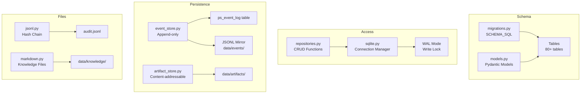

# Data Layer Overview

The **Data Layer** (`aletheia/storage/`) is Aletheia's central data management system. It uses **SQLite** as the primary storage engine, with a well-defined schema for market data, positions, knowledge, learning, and audit records.

## Architecture



## Database Schema

### Schema Version

**Current schema version:** `aletheia-sqlite-v29` (`SCHEMA_VERSION` in `migrations.py`).

### Core Tables

| Table | Description |
|---|---|
| `settings` | Key-value settings |
| `agent_runs` | Agent execution runs |
| `agent_run_steps` | Agent run steps |
| `agent_tool_calls` | Agent tool invocations |
| `opportunities` | Trading opportunities |
| `trade_proposals` | Trade proposals |
| `proposal_execution_claims` | Execution lease claims |
| `entry_risk_reservations` | Pre-order risk reservations |
| `risk_decisions` | Risk evaluation decisions |
| `approvals` | Proposal approvals |
| `orders` | Orders (placed, filled, cancelled) |
| `fills` | Trade execution fills |
| `positions` | Active positions |
| `shadow_trades` | Shadow trade records |
| `alpha_control_observations` | Alpha control observations |
| `filter_decisions` | Per-candidate filter decisions |
| `filter_decision_batches` | Compressed filter batch facts |
| `filter_candidate_outcomes` | Fixed-horizon net results |
| `serenity_themes` | Serenity research themes |
| `serenity_evidence` | Serenity evidence |
| `serenity_opportunities` | Serenity opportunities |
| `serenity_risk_gates` | Serenity risk gates |
| `portfolio_snapshots` | Portfolio snapshots |
| `strategy_records` | Strategy records |
| `strategy_experiments` | Strategy experiments |
| `knowledge_items` | Knowledge items |
| `market_snapshots` | Market snapshots |
| `audit_events` | Audit events |
| `news_items` | News items |
| `market_ohlcv` | OHLCV candlestick data |
| `runtime_registry` | Runtime registry |
| `runtime_checkpoints` | Runtime checkpoints |
| `runtime_events` | Runtime events |
| `runtime_exclusive_lock` | Runtime exclusive locks |
| `runtime_ownership` | Runtime ownership |
| `agent_shell_sessions` | Agent shell sessions |
| `agent_shell_commands` | Agent shell commands |
| `agent_shell_messages` | Agent shell messages |
| `agent_shell_tasks` | Agent shell tasks |
| `agent_shell_artifacts` | Agent shell artifacts |
| `agent_shell_heartbeats` | Agent shell heartbeats |
| `agent_shell_events` | Agent shell events |
| `extension_registry` | Extension registry |
| `extension_runs` | Extension runs |
| `serenity_research_runs` | Serenity research runs |
| `serenity_run_events` | Serenity run events |
| `serenity_user_profiles` | Serenity user profiles |
| `serenity_profile_snapshots` | Serenity profile snapshots |
| `serenity_feedback_events` | Serenity feedback events |
| `serenity_claims` | Serenity claims |
| `serenity_theme_claims` | Serenity theme claims |
| `serenity_agent_locks` | Serenity agent locks |
| `ps_event_log` | Persistence event log |
| `ps_gateway_sessions` | Persistence gateway sessions |
| `ps_gateway_locks` | Persistence gateway locks |
| `ps_reconciliation_reports` | Persistence reconciliation reports |
| `ps_execution_intents` | Persistence execution intents |
| `ps_order_intents` | Persistence order intents |
| `ps_orders` | Persistence orders |
| `ps_fills` | Persistence fills |
| `ps_positions` | Persistence positions |
| `ps_checkpoints` | Persistence checkpoints |
| `ps_lessons` | Persistence lessons |
| `ps_skills` | Persistence skills |
| `ps_policy_versions` | Persistence policy versions |
| `ps_scheduled_jobs` | Persistence scheduled jobs |
| `ps_job_runs` | Persistence job runs |
| `universe_registry` | Universe asset registry |
| `universe_feature_snapshots` | Universe feature snapshots |
| `universe_scanner_runs` | Universe scanner runs |
| `universe_snapshots` | Universe snapshots |
| `universe_members` | Universe members |
| `universe_forward_outcomes` | Universe forward outcomes |
| `universe_policies` | Universe policies |
| `runtime_sessions` | Runtime sessions |

### Data Collector Tables

| Table | Description |
|---|---|
| `orderbook_snapshots` | L1/L2 order book data |
| `funding_rate_snapshots` | Perpetual funding rates |
| `open_interest_snapshots` | Open interest data |
| `liquidation_events` | Liquidation events |
| `perp_structure_snapshots` | Vergex-style market structure |
| `perp_structure_shadow_outcomes` | Shadow outcomes for structure |
| `macro_snapshots` | Macro indicators |
| `coingecko_top_snapshots` | CoinGecko top-N markets |
| `onchain_snapshots` | DefiLlama on-chain aggregates |

### Learning Tables

| Table | Description |
|---|---|
| `learning_hypotheses` | Learning hypotheses |
| `learning_experiments` | Learning experiments |
| `learning_exposures` | Learning exposures |
| `learning_contribution_verdicts` | Learning contribution verdicts |
| `learning_lifecycle_events` | Learning lifecycle events |
| `learning_job_health` | Learning job health |
| `learning_policy_epochs` | Learning policy epochs |

### Other Tables

| Table | Description |
|---|---|
| `prediction_observer_runs` | Prediction observer runs |
| `prediction_events` | Prediction events |
| `prediction_markets` | Prediction markets |
| `prediction_probability_snapshots` | Prediction probability snapshots |
| `prediction_market_claims` | Prediction market claims |
| `backtest_runs` | Backtest runs |
| `backtest_trades` | Backtest trades |
| `market_regimes` | Market regimes |
| `pi_decisions` | System Operator decisions |
| `operator_evaluation_events` | Operator evaluation events |
| `capital_events` | Deposits/withdrawals |
| `paper_account_events` | Paper account events |
| `position_close_events` | Per-close ledger |
| `volume_ranking_snapshots` | Volume ranking snapshots |
| `ohlcv_backfill_state` | OHLCV backfill state |
| `collector_health_state` | Collector health state |
| `controller_recommendations` | Controller recommendations |
| `filter_shadow_experiments` | Filter shadow experiments |
| `filter_shadow_evaluations` | Filter shadow evaluations |
| `committee_reports` | Committee reports |
| `aletheia_schema_migrations` | Migration ledger |
| `position_path_observations` | 5m bar observations |
| `position_path_observation_deferred_buckets` | Deferred observation buckets |
| `position_path_observer_cursor` | Observer cursor |
| `universe_twin_shadow_batches` | Twin shadow batches |
| `universe_twin_shadow_records` | Twin shadow records |
| `position_exit_plan_versions` | Exit plan versions |
| `position_protection_state` | Protection state |
| `position_protection_triggers` | Protection triggers |
| `exit_breakeven_shadow_assignments` | Exit breakeven shadow assignments |
| `exit_breakeven_shadow_outcomes` | Exit breakeven shadow outcomes |
| `historical_accounting_reconciliations` | Historical accounting reconciliations |
| `outcome_hook_jobs` | Outcome hook jobs |
| `agent_run_artifacts` | Agent run artifacts |
| `learning_lesson_reviewer_attempts` | Lesson reviewer attempts |
| `knowledge_fts` | FTS5 full-text search index |

## Repository Layer Pattern

**Source:** `aletheia/storage/repositories.py`

The repository layer is a set of thin CRUD functions over SQLite:

1. **No ORM** — raw SQL via `execute_write`, `execute_many_write`, `get_db`.
2. **Pydantic models** — data is validated via Pydantic models from `models.py` before insertion.
3. **Provenance stamping** — `_stamp_provenance(data)` fills `runtime_session_id`, `producer_commit`, `behavior_fingerprint`.
4. **Write serialization** — all writes go through `acquire_write_lock()` / `release_write_lock()`.
5. **Transaction context manager** — `transaction()` provides nested transactions with savepoints.

### Key Repository Functions

- `insert_runtime_session(session)` — Persists a RuntimeSession.
- `insert_audit_event(event)` — Append-only audit fact.
- `insert_agent_run(run)` — Persist agent run.
- `insert_opportunity(opp)` — Insert with provenance stamping.
- `list_open_trade_opportunities(limit)` — Bounded, starvation-free workset.
- `insert_committee_report(report)` — Persist committee evaluation.
- `transition_open_opportunity_to_queued(oid)` — CAS claim for queue insertion.

## SQLite Connection Management (`storage/sqlite.py`)

- **One connection per OS thread** — eliminates "database is locked" races
- **Process-level write serialization** — `threading.Lock`
- **Cross-process write lock** — `fcntl.flock` (POSIX) or `msvcrt.locking` (Windows) on a `.write.lock` file
- **WAL mode** — `PRAGMA journal_mode=WAL`
- **Foreign keys** — `PRAGMA foreign_keys=ON`
- **busy_timeout = 30000ms** — last-resort SQLite fallback
- **Application writer permit timeout = 6s** — fail fast

## Event Store (`storage/event_store.py`)

- **Append-only** event store backed by **SQLite + JSONL dual-write**
- **Idempotency** via `idempotency_key` — duplicate keys return the previously persisted event
- **Machine ID** from `platform.node()`

### JSONL Mirror

Events are written to `ps_event_log` table AND mirrored to JSONL files at `data/events/event_log_YYYY-MM-DD.jsonl`. The mirror is best-effort; DB is the source of truth.

## Artifact Store (`storage/artifact_store.py`)

- **Content-addressable** artifact store rooted at `data/artifacts/`
- **Atomic writes** — write to `.tmp` then rename
- **Integrity verification** via SHA-256

## Hashing Utilities (`storage/hashing.py`)

```python
def canonical_json(obj: dict | list) -> str   # sorted keys, no whitespace
def sha256_bytes(data: bytes) -> str
def sha256_json(obj: dict | list) -> str       # canonical JSON → SHA-256
def sha256_file(path: Path | str) -> str       # streaming, memory-safe
def content_hash(text: str) -> str             # UTF-8 text → SHA-256
```

## Files Module

### `jsonl.py` — JSONL Event Stream Writer/Reader

- `append_jsonl(filename, record)` — appends a JSON record to `logs/<filename>`, rotating at a size cap.
- `write_audit(record)` — maintains a SHA-256 hash chain for `audit.jsonl` (the only sanctioned way to write audit records).
- **Rotation:** When the active file exceeds `retention.jsonl_max_mb` (default 50MB), it's rotated to numeric generations.
- **Forbidden direct writes:** `append_jsonl("audit.jsonl", ...)` raises `ValueError`.

### `markdown.py` — Markdown File Writer

- `write_research_note(title, content, metadata)`
- `write_strategy_doc(strategy_id, title, content)`
- `write_dreaming_log(title, content)`
- `write_daily_review(content, title)`
- `write_post_trade_review(title, content, metadata)`
- `write_trade_case_study(title, content, metadata)`
- `write_trading_guard(title, content, metadata)`

All use `_write_knowledge_file(subdir, title, content, metadata)` which:
- Creates `get_data_dir() / "knowledge" / subdir /`
- Generates a filename: `YYYYMMDD-HHMMSS-<4hex>-<safe_name>.md`
- Writes atomically via `.tmp` + `os.replace`
- Prepends a YAML frontmatter header if metadata is provided

### `paths.py` — Common File Path Helpers

```python
def knowledge_dir() -> Path   # get_data_dir() / "knowledge"
def playbooks_dir() -> Path   # get_data_dir() / "playbooks"
def reports_dir() -> Path     # get_data_dir() / "reports"
def logs_dir() -> Path        # get_data_dir() / "logs"
```

## Data Models

All models are Pydantic v2 `BaseModel` subclasses. Key models:

| Model | Description |
|---|---|
| `RuntimeSession` | One Gateway process lifecycle |
| `AuditEvent` | Append-only audit fact |
| `AgentRun` | Agent execution run |
| `Opportunity` | Trading opportunity |
| `TradeProposal` | Trade proposal with hash chain |
| `RiskDecision` | Risk decision |
| `Order` | Order |
| `Fill` | Fill |
| `Position` | Position with dual provenance |
| `StrategyRecord` | Strategy record |
| `KnowledgeItem` | Knowledge item |
| `MarketSnapshot` | Market snapshot |
| `PortfolioSnapshot` | Portfolio snapshot |
| `SerenityTheme` | Serenity research theme |
| `SerenityEvidence` | Serenity evidence |
| `SerenityOpportunity` | Serenity opportunity |
| `PSEvent` | Persistence event |
| `PSArtifactRef` | Artifact reference |
| `UniverseAsset` | Universe asset |
| `UniverseFeatureSnapshot` | Feature snapshot |
| `UniverseScannerRun` | Scanner run |
| `UniverseSnapshot` | Snapshot |
| `UniverseMember` | Member |
| `UniverseForwardOutcome` | Forward outcome |
| `UniversePolicy` | Policy |

## Key Invariants

1. **WAL mode** — The database is SQLite in WAL mode with foreign keys enabled.
2. **Write serialization** — All writes go through a process-level write lock.
3. **Provenance** — Every core trading-fact row carries `runtime_session_id`, `producer_commit`, `behavior_fingerprint`.
4. **Dual-write events** — Events are persisted to SQLite + JSONL mirror for durability.
5. **Content-addressable artifacts** — SHA-256 verified artifact storage.

## Relationship to Other Components

- [Data Layer Migrations](migrations.md) — Migration system details
- [Trading Loop](../architecture/trading-loop.md) — Full evidence pipeline
- [Configuration System](../config/configuration.md) — Config and secrets
