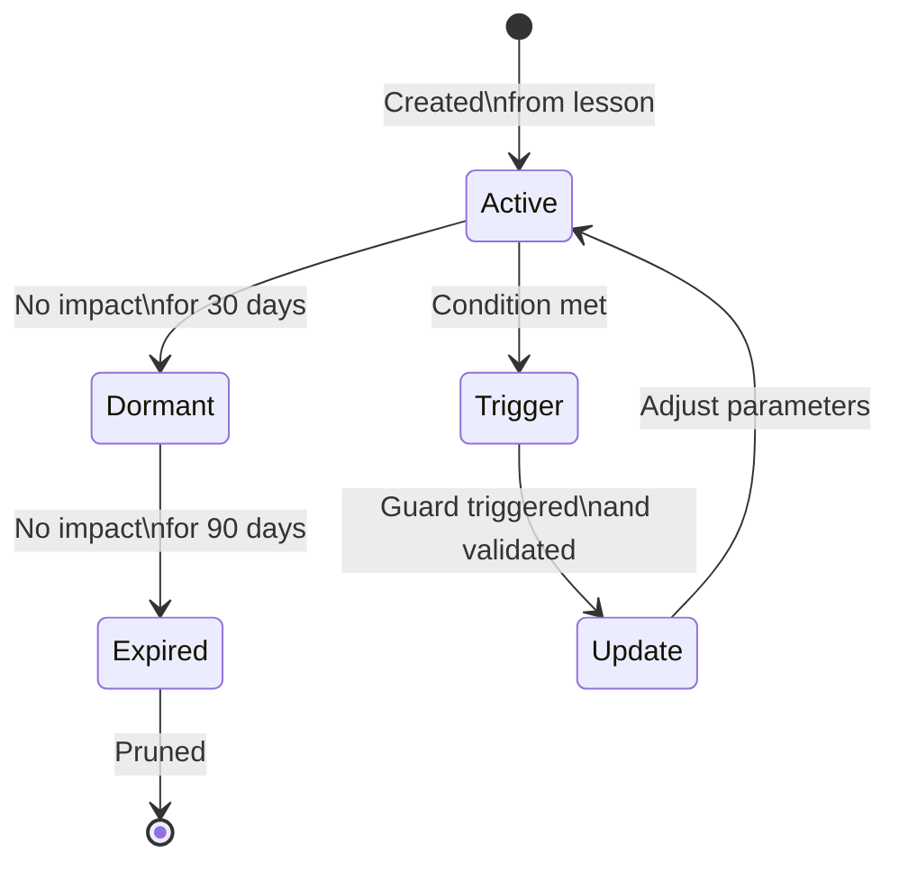

# Knowledge System

The **Knowledge System** (`aletheia/knowledge/`) is Aletheia's memory and reasoning framework. It aggregates lessons from all analysis layers, generates **guardrails** (safety rules derived from learned failures), cross-references facts across data sources, and runs weekly **Knowledge Maintenance** to prune stale knowledge and validate active guardrails.

## Architecture

```mermaid
flowchart TD
    A[Fact Critic] --> B[Knowledge Base]
    B --> C[Lesson Aggregator]
    C --> D1[Lessons DB\n(failed assumptions)]
    C --> D2[Guardrails DB\n(active rules)]
    B --> E[Cross-Ref Engine]
    E --> F1[News ↔ Market\nCorrelation]
    E --> F2[Prediction ↔ Reality\nValidation]
    E --> F3[Regime ↔ Performance\nAnalysis]
    B --> G[Maintenance Scheduler\n(Weekly)]
    G --> H1[Prune Stale Lessons]
    G --> H2[Validate Guardrails]
    G --> H3[Merge Duplicate Facts]
    G --> H4[Archive Low-Confidence]
    B --> I[Learning Authority]
    I --> J[Authority Resolver\n(L0-L4)]
```

## Core Components

### Fact Critic

**Source:** `knowledge/fact_critic.py`, `knowledge/fact_critic_v2.py`

The Fact Critic cross-references facts from different sources:

1. **Market ↔ News** — Validates news sentiment against price action
2. **Prediction ↔ Reality** — Compares prediction probabilities vs actual outcomes
3. **Regime ↔ Performance** — Validates regime assessments against actual performance
4. **LLM ↔ Data** — Checks LLM claims against historical data

```python
def fact_critic_cross_ref(fact, sources):
    """Cross-reference a fact across multiple sources."""
    scores = {}
    for source in sources:
        confidence = validate_source(source, fact)
        scores[source] = confidence
    
    # If average confidence < threshold, create a guardrail
    if average_confidence(scores) < 0.6:
        create_guardrail(fact, scores)
```

### Lesson Aggregator

**Source:** `learning/control.py`, `knowledge/maintenance.py`

Collects lessons from all components:

| Source | Lesson Type |
|---|---|
| Committee analysis | Failed assumptions about opportunities |
| Risk Engine | Risk model misses |
| Execution Gateway | Execution slippage patterns |
| Fact Critic | Cross-reference failures |
| Serenity Lens | Regime misclassifications |

Lessons are stored in the `knowledge_base` table with:
- Content (the lesson)
- Domain (which component/system)
- Confidence (0.0-1.0)
- Valid (boolean)
- Expiry (auto-expiry timestamp)

### Cross-Reference Engine

**Source:** `knowledge/cross_ref.py`

Runs cross-reference checks every cycle:

```python
CROSS_REF_CHECKS = [
    ("news_sentiment_vs_price", check_news_vs_price),
    ("prediction_vs_actual", check_prediction_accuracy),
    ("regime_vs_performance", check_regime_performance),
    ("llm_claim_vs_data", check_llm_claims),
    ("guardrail_impact", check_guardrail_effectiveness),
]
```

## Guardrails

**Source:** `knowledge/guards.py`, `knowledge/guard_lifecycle.py`

Guardrails are **safety rules** generated from learned lessons. They influence:
- Risk Engine risk multipliers
- Position Manager exit triggers
- Serenity Lens regime assessment
- Knowledge Base fact validation

### Guardrail Types

| Type | Source | Effect |
|---|---|---|
| `risk_guard` | Risk failures | Adjust risk multipliers per regime |
| `entry_guard` | Bad entries | Block entry to certain opportunities |
| `exit_guard` | Bad exits | Trigger early exits |
| `regime_guard` | Regime errors | Adjust regime assessment confidence |
| `cost_guard` | LLM waste | Block high-cost LLM calls |
| `learned_behavior_guard` | Learning experiments | Gate learned behavior influence |

### Guardrail Lifecycle



## Knowledge Maintenance

**Source:** `knowledge/maintenance.py`

Weekly maintenance window (runs Sunday at 00:00 UTC):

1. **Prune stale lessons** — Remove lessons older than 90 days with no impact
2. **Validate active guardrails** — Check if guardrails are still effective
3. **Merge duplicate facts** — Combine semantically similar knowledge entries
4. **Archive low-confidence** — Move confidence < 0.3 knowledge to archive
5. **Recompute authority** — Update Learning Authority weights based on recent performance

### Confidence Decay

Knowledge entries decay over time:

```python
def decay_confidence(knowledge_entry, days_old):
    """Apply time-based confidence decay."""
    base_decay = 0.01 * days_old  # 1% per day
    # Faster decay for volatile domains
    if knowledge_entry.domain in ["serenity", "risk"]:
        base_decay *= 1.5
    return max(0.1, knowledge_entry.confidence - base_decay)
```

## Learning Authority

**Source:** `learning/authority.py`

The Learning Authority tracks which learned behaviors have authority to influence the system:

| Authority Level | Description |
|---|---|
| `L0` — Frozen | Behavior has no influence |
| `L1` — Paper-only | Behavior influences paper trading only |
| `L2` — Limited | Behavior influences paper + small live trades |
| `L3` — Full | Behavior influences all trading |

Authority is resolved by the Learning Authority based on:
- Experiment verdicts
- Risk-adjusted performance
- Time since promotion
- Cross-referencing validation

## Knowledge Query

**Source:** `knowledge/query.py`

```python
# Search knowledge
results = knowledge_base.search("ETH staking yield", domain="risk")

# Get active guardrails
guards = knowledge_base.get_active_guards()

# Get specific fact
fact = knowledge_base.get_fact(fact_id="kb_12345")

# Confidence-filtered search
facts = knowledge_base.search("volatility regime", min_confidence=0.7)
```

## Key Symbols

| Symbol | Location | Description |
|---|---|---|
| `KnowledgeBase` | `knowledge/base.py` | Main KB class |
| `FactCritic` | `knowledge/fact_critic.py` | Cross-referencing |
| `LessonAggregator` | `learning/control.py` | Lesson collection |
| `GuardLifecycle` | `knowledge/guard_lifecycle.py` | Guardrail lifecycle |
| `KnowledgeMaintenance` | `knowledge/maintenance.py` | Weekly maintenance |
| `LearningAuthority` | `learning/authority.py` | Authority tracking |
| `AuthorityLevel` | `learning/authority.py` | Authority levels |
| `cross_reference_all` | `knowledge/cross_ref.py` | All cross-ref checks |

## Test Coverage

- `tests/test_knowledge_base.py` — Tests for KB storage, retrieval
- `tests/test_fact_critic.py` — Tests for cross-referencing
- `tests/test_guardrails.py` — Tests for guardrail lifecycle
- `tests/test_knowledge_maintenance.py` — Tests for pruning, validation
- `tests/test_learning_authority.py` — Tests for authority resolution
- `tests/test_cross_ref.py` — Tests for cross-reference engine

## Relationship to Other Components

- [Learning System](../components/learning-system.md) — Lessons, experiments
- [Risk Engine](../components/risk-engine.md) — Risk guardrails
- [Position Manager](../components/position-manager.md) — Exit guardrails
- [Serenity Lens](../components/serenity-lens.md) — Regime guardrails
- [Fact Critic](fact-critic.md) — Fact cross-referencing
- [Model Provider](../components/model-provider.md) — Cost guardrails
