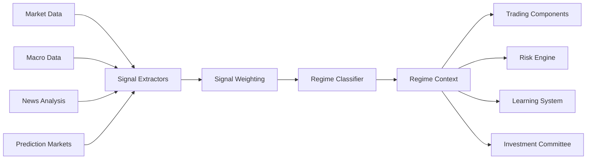

# Regime Detection System

The **Regime Detection System** classifies current market conditions into discrete regimes that inform trading strategy selection, risk parameters, and behavior authority levels.

## Overview

**Source:** `regime/detector.py`, `regime/classifier.py`

<!-- openwiki: broken internal link [components/risk-engine.md] file "components/risk-engine.md" does not exist. Fix the href or restore the target, then delete this comment. -->
<!-- openwiki: broken internal link [components/serenity-lens.md] file "components/serenity-lens.md" does not exist. Fix the href or restore the target, then delete this comment. -->
<!-- openwiki: broken internal link [components/learning-system.md] file "components/learning-system.md" does not exist. Fix the href or restore the target, then delete this comment. -->
The system aggregates signals from multiple data sources, applies weighted scoring, and assigns a regime label. The current regime is a piece of context available to all system components including the [Risk Engine](components/risk-engine.md), [Serenity Lens](components/serenity-lens.md), and [Learning System](components/learning-system.md).



## Regime Types

The system classifies markets into the following regimes:

| Regime | Characteristics | Typical Response |
|---|---|---|
| `TRENDING_UP` | Sustained upward price movement | Trend-following strategies |
| `TRENDING_DOWN` | Sustained downward price movement | Short bias, defensive positioning |
| `SIDEWAYS` | Low volatility, range-bound | Mean-reversion strategies |
| `HIGH_VOLATILITY` | Elevated volatility, large price swings | Reduced position sizing |
| `LOW_VOLATILITY` | Compressed volatility, stable prices | Increased confidence in predictions |
| `BREAKING_NEWS` | Active news events | Conservative execution, wider spreads |
| `CRISIS` | Market dysfunction, extreme moves | Emergency risk controls |

## Signal Sources

### Volatility Signals

**Source:** `regime/volatility.py`

- Realized volatility over multiple windows (5m, 15m, 1h, 4h, 24h)
- Implied volatility vs. realized volatility divergence
- Volatility of volatility (vol-of-vol)
- Volatility regime persistence

### Microstructure Signals

**Source:** `regime/microstructure.py`

- Orderbook depth and imbalance
- Bid-ask spread widths
- Order flow imbalance
- Trade size distribution
- Cancellation rates

### Macro Signals

**Source:** `regime/macro.py`

- VIX (volatility index)
- DXY (dollar strength index)
- Yield curve shape
- Economic calendar events
- Risk asset correlations

### News Signals

**Source:** `regime/news.py`

<!-- openwiki: broken internal link [components/news-analyzer.md] file "components/news-analyzer.md" does not exist. Fix the href or restore the target, then delete this comment. -->
- News sentiment scores from [News Analyzer](components/news-analyzer.md)
- Entity-specific sentiment (per asset)
- Breaking news detection
- Regulatory event detection

### Prediction Market Signals

**Source:** `regime/prediction_markets.py`

- Prediction market price movements
- Market liquidity and depth
- Consensus divergence from exchange prices

## Classification Algorithm

### Weighted Scoring

Each signal source produces a normalized score (0.0 to 1.0). Signals are weighted based on:

1. **Recency** — More recent signals have higher weight
2. **Confidence** — Higher-confidence signals have higher weight
3. **Historical accuracy** — Signals that historically predicted regime changes accurately get higher weight

### Decision Logic

**Source:** `regime/classifier.py`

The classifier uses a multi-rule system:

```python
class RegimeClassifier:
    """Market regime classifier."""
    
    def classify(self, signals: Dict[str, float]) -> RegimeType:
        """Classify market regime from signals."""
        # Primary signal determines base regime
        if signals["volatility"] > 0.8:
            base = RegimeType.HIGH_VOLATILITY
        elif signals["trend_strength"] > 0.7:
            base = RegimeType.TRENDING_UP if signals["trend_direction"] > 0 else RegimeType.TRENDING_DOWN
        else:
            base = RegimeType.SIDEWAYS
        
        # Override conditions
        if signals["news_impact"] > 0.9:
            return RegimeType.BREAKING_NEWS
        if self.is_crisis(signals):
            return RegimeType.CRISIS
        
        return base
```

### Confidence Scoring

Each regime classification includes a confidence score (0.0 to 1.0). Low confidence regimes trigger:
- Reduced position sizes
- Increased monitoring frequency
- Alert to operators

## Regime Context Distribution

<!-- openwiki: broken internal link [runtime/system-operator.md] file "runtime/system-operator.md" does not exist. Fix the href or restore the target, then delete this comment. -->
The current regime is distributed to consumers via the [System Operator](runtime/system-operator.md) context, which stores:

```python
class RegimeContext:
    """Current market regime context."""
    current_regime: RegimeType
    confidence: float
    timestamp: datetime
    contributing_signals: Dict[str, float]
    regime_duration: timedelta  # How long current regime has persisted
```

## Test Coverage

- `tests/test_regime_detector.py` — Tests for signal extraction
- `tests/test_regime_classifier.py` — Tests for classification logic
- `tests/test_regime_signals.py` — Tests for individual signal sources
- `tests/test_regime_context.py` — Tests for context distribution

## Relationship to Other Components

<!-- openwiki: broken internal link [components/risk-engine.md] file "components/risk-engine.md" does not exist. Fix the href or restore the target, then delete this comment. -->
- [Risk Engine](components/risk-engine.md) — Adjust risk parameters per regime
<!-- openwiki: broken internal link [components/serenity-lens.md] file "components/serenity-lens.md" does not exist. Fix the href or restore the target, then delete this comment. -->
- [Serenity Lens](components/serenity-lens.md) — Regime affects uncertainty measurement
<!-- openwiki: broken internal link [components/prediction-lens.md] file "components/prediction-lens.md" does not exist. Fix the href or restore the target, then delete this comment. -->
- [Prediction Lens](components/prediction-lens.md) — Regime filters prediction validity
<!-- openwiki: broken internal link [components/learning-system.md] file "components/learning-system.md" does not exist. Fix the href or restore the target, then delete this comment. -->
- [Learning System](components/learning-system.md) — Regime gates behavior authority
