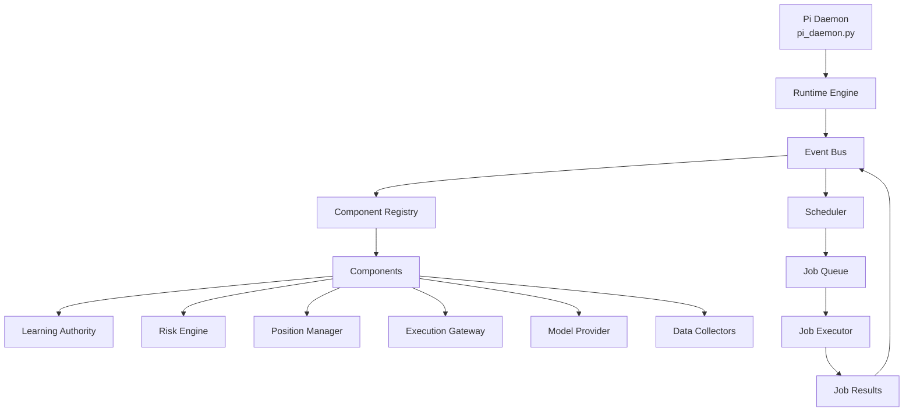

# Runtime Engine

The **Runtime Engine** (`aletheia/runtime/`) is Aletheia's event-driven async execution core. It runs as the "Pi Daemon" — a persistent background process that manages component lifecycles, schedules periodic jobs, and coordinates inter-component communication through an event bus.

## Architecture



## Pi Daemon

**Source:** `agent_runtime/pi_daemon.py`

The Pi Daemon is the main entry point for the runtime:

```bash
python -m aletheia.agent_runtime.pi_daemon
```

Responsibilities:
1. **Bootstrap** — Initialize all components
2. **Schedule** — Start scheduler jobs
3. **Monitor** — Health check all components
4. **Persist state** — Runtime state to SQLite
5. **Signal handling** — Graceful shutdown on SIGTERM/SIGINT

## Component Lifecycle

**Source:** `runtime/lifecycle.py`

Components follow a 4-phase lifecycle:

```
┌──────┐    ┌─────────┐    ┌──────┐    ┌───────┐
│ INIT │ →  │ STARTED │ →  │ READY │ →  │ STOPPED│
└──────┘    └─────────┘    └──────┘    └───────┘
   ↓             ↓             ↓           ↑
register      activate     health_check    cleanup
```

| Phase | Description | Hook |
|---|---|---|
| `INIT` | Component created, dependencies injected | `on_init()` |
| `STARTED` | Component activated, resources allocated | `on_start()` |
| `READY` | Component healthy, accepting work | `on_ready()` |
| `STOPPED` | Component shut down, resources freed | `on_stop()` |

## Event Bus

**Source:** `runtime/event_bus.py`

Async event bus for inter-component communication:

```python
# Publish an event
await event_bus.publish("regime.changed", {
    "regime": "volatile",
    "confidence": 0.85,
    "prev_regime": "bull"
})

# Subscribe to events
@event_bus.subscribe("regime.changed")
async def on_regime_change(event):
    await position_manager.adjust_for_regime(event.data)
```

### Event Types

| Event | Source | Consumers |
|---|---|---|
| `regime.changed` | Serenity Lens | Position Manager, Risk Engine |
| `learning.verdict` | Learning Authority | Risk Engine, Knowledge Base |
| `data.stale` | Data Freshness | Signal Engine, Scheduler |
| `opportunity.discovered` | Universe | Committee, Risk Engine |
| `trade.executed` | Execution Gateway | Position Manager, Audit |
| `guard.triggered` | Knowledge Base | Risk Engine, Position Manager |

## Scheduler Integration

**Source:** `runtime/scheduler_integration.py`

The runtime starts and monitors the scheduler jobs:

```python
JOBS = [
    ("collect_market_data", "0 */2 * * *"),      # Every 2 hours
    ("refresh_universe", "*/5 * * * *"),          # Every 5 minutes
    ("check_learning_verdicts", "0 * * * *"),     # Hourly
    ("knowledge_maintenance", "0 0 * * 0"),       # Weekly
    ("portfolio_rebalancing", "0 0 * * 1"),       # Weekly
    ("data_backup", "0 2 * * *"),                 # Daily at 2 AM
]
```

## Health Monitoring

**Source:** `runtime/health.py`

Each component reports health status:

```python
class ComponentHealth:
    name: str
    status: HealthStatus  # HEALTHY, DEGRADED, UNHEALTHY
    last_check: datetime
    errors: List[str]
    metrics: Dict[str, float]
```

Health is checked every 30 seconds. If a component is unhealthy:
1. Alert logged to `runtime_health` table
2. Alert sent to System Operator
3. If critical, runtime initiates graceful degradation

## Runtime State Persistence

**Source:** `runtime/state.py`

Runtime state is persisted to the `runtime_state` SQLite table:

| Key | Description |
|---|---|
| `last_cycle` | Last trading cycle timestamp |
| `current_regime` | Current market regime |
| `learning_stage` | Current learning stage (0-4) |
| `autonomous_level` | Current autonomous authority level |
| `active_positions` | Count of active positions |
| `paper_nav` | Paper trading NAV |
| `component_status` | Last known status of each component |

## Graceful Shutdown

**Source:** `runtime/shutdown.py`

On SIGTERM/SIGINT:
1. Stop accepting new work
2. Cancel pending jobs
3. Flush all queues
4. Stop components in reverse order
5. Persist runtime state
6. Close database connections

## Key Symbols

| Symbol | Location | Description |
|---|---|---|
| `PiDaemon` | `agent_runtime/pi_daemon.py` | Main daemon entry |
| `RuntimeEngine` | `runtime/engine.py` | Runtime core |
| `EventBus` | `runtime/event_bus.py` | Event bus |
| `ComponentRegistry` | `runtime/registry.py` | Component registry |
| `LifecycleManager` | `runtime/lifecycle.py` | Lifecycle management |
| `ComponentHealth` | `runtime/health.py` | Health status |
| `RuntimeState` | `runtime/state.py` | State persistence |
| `graceful_shutdown` | `runtime/shutdown.py` | Shutdown handler |

## Test Coverage

- `tests/test_runtime_engine.py` — Tests for engine lifecycle
- `tests/test_event_bus.py` — Tests for event publish/subscribe
- `tests/test_component_registry.py` — Tests for registry
- `tests/test_health_monitoring.py` — Tests for health checks
- `tests/test_runtime_state.py` — Tests for state persistence
- `tests/test_shutdown.py` — Tests for graceful shutdown

## Relationship to Other Components

- [Scheduler](scheduler.md) — Job scheduling integration
- [Learning System](../components/learning-system.md) — Learning authority
- [Risk Engine](../components/risk-engine.md) — Risk decisions
- [Position Manager](../components/position-manager.md) — Position management
- [Execution Gateway](../components/execution-gateway.md) — Order execution
