# Agent Runtime

The **Agent Runtime** (`aletheia/agent_runtime/`) is Aletheia's infrastructure layer that schedules, monitors, and gates all automated work. It is the platform layer beneath the decision-making agent shell.

## Architecture

```mermaid
flowchart TD
    subgraph Scheduler
        A[init_scheduler\nAPScheduler] --> B[30+ Jobs\n11 Executor Pools]
        B --> C[_run_job_guarded\nMemory pressure gate]
    end

    subgraph PI Daemon
        D[notify_pi_daemon\nThread-safe signal] --> E[_pi_daemon_loop\nasyncio.Task]
        E --> F[WakeCoalescer\n3s coalesce window]
        F --> G[Token Bucket\n15/hour per position]
        G --> H[evaluate_trading_opportunity\nor review_portfolio_state]
    end

    subgraph Health
        I[compute_health\nReal backend signals] --> J{Healthy?}
        J -->|Yes| K[Continue]
        J -->|No| L[Alert + Self-heal]
    end

    subgraph Startup Gates
        M[probe_llm_providers_at_startup\nReal completion] --> N{Any usable?}
        N -->|Yes| O[Start agents]
        N -->|No| P[Pause + auto_resume]
    end

    subgraph Session
        Q[start_runtime_session\nOne per boot] --> R[current_provenance\nStamp child rows]
    end
```

## Scheduler (`agent_runtime/scheduler.py`)

The central orchestration engine for all automated work. Uses APScheduler with 11 isolated thread-pool executors.

### Public API

| Function | Signature | Description |
|---|---|---|
| `init_scheduler` | `() -> BackgroundScheduler \| None` | Creates the scheduler with 11 executors, registers ~40 jobs, starts it. |
| `stop_scheduler` | `() -> None` | Shuts down the scheduler and closes timeout workers. |
| `pause_scheduler` | `(layered: bool \| None = None) -> None` | Layered (non-essential only) or blanket pause. |
| `resume_scheduler` | `() -> bool` | Resumes only when no durable pause owner remains. |
| `notify_paper_trader` | `(source: str = "unknown") -> bool` | Pulls paper_trader's next fire time forward. |

### Executor Pools

11 isolated pools to prevent starvation: `default: 2`, `io: 1`, `audit: 1`, `fast_io: 1`, `protective: 1`, `learning_measurement: 1`, `observer: 1`, `agents: 1`, `universe: 1`

### Job Categories

- **Essential jobs** (`_ESSENTIAL_JOBS`): market_data, data_collectors, connectivity_monitor, portfolio_snapshot, price_feed, position_manager, health_check, reconciliation, etc. — always run, even under pause.
- **Non-essential jobs** (`NON_ESSENTIAL_JOBS`): market_observer, dreaming_agent, paper_trader, pi_trading_decision, post_trade_reviewer, risk_critic, etc. — skipped under memory pressure or layered pause.

### Timeout Workers

Process-owned bounded workers prevent thread explosion:
- `_PersistentAsyncTimeoutWorker` — one persistent asyncio loop per worker, capacity 16.
- `_PersistentSyncTimeoutWorker` — one daemon sync worker, capacity 16.
- `_run_async_with_timeout` — wraps coroutines with hard wall-clock bounds.
- `_run_sync_with_timeout` — runs sync work on bounded lanes.

## PI Daemon (`agent_runtime/pi_daemon.py`)

The event-driven System Operator daemon. See [Agent Decision Loop](../architecture/agent-decision-loop.md) and [PI Daemon Service](../services/pi-daemon.md) for full details.

### Public API

| Function | Signature | Description |
|---|---|---|
| `notify_pi_daemon` | `(source: str = "unknown", event: WakeEvent \| None = None) -> bool` | Thread-safe signal to wake the daemon. |
| `start_pi_daemon` | `(loop, debounce_sec=8.0, cooldown_sec=60.0, heartbeat_sec=300.0, ...) -> asyncio.Task \| None` | Creates the daemon task. |
| `stop_pi_daemon` | `() -> None` | Cancels the task, clears module-level state. |
| `reconfigure_pi_daemon` | `(enabled, debounce_sec, cooldown_sec, heartbeat_sec, loop) -> dict` | Hot-reconfigures without gateway restart. |

## Health Monitoring (`agent_runtime/health.py`)

Computes health from REAL backend signals and alerts only on transition INTO an unhealthy state.

### `compute_health() -> dict`

Returns `{healthy, status, issues}`. Status: "healthy" | "degraded" | "initializing".

**Health signals checked:**
- Agent failure ratio (last 20 runs)
- Kill switch active
- Trading paused while scheduler enabled
- Startup behavior gate blockers
- Market data freshness
- LLM consecutive failures
- Observer freshness
- Exchange connectivity
- Code drift (disk source committed past boot)
- Runtime session provenance durability

### Self-heal

`_trigger_restart(reason)` audits FIRST, then `os._exit(42)` for supervisor respawn. Rate-limited via persisted audit log.

## Startup Gate (`agent_runtime/startup_gate.py`)

At gateway startup, probes every enabled model provider with a REAL inference call. If none can complete, the trading loop must NOT run.

### `probe_llm_providers_at_startup(cfg, *, max_retries=None) -> dict`

Returns `{any_usable, results: [{provider, usable, error}], checked, attempts}`.

**Why a real completion:** `claude_cli`'s healthcheck returns `available=True` whenever the `claude` binary exists, even when real inference times out. Only a real `complete()` call answers "can this provider actually do inference right now?"

**Retry logic:** Retries up to `startup_gate_max_retries` (default 3) with `startup_gate_retry_delay_sec` (default 15s) between attempts.

## Startup Behavior Gate (`agent_runtime/startup_behavior_gate.py`)

A gateway process can be "up" while being in a state where it must NOT make new AI decisions. This gate makes the startup sequence honest.

### Individual checks:
- `_check_migrations_applied` — required tables exist
- `_check_sqlite_integrity` — `PRAGMA integrity_check`
- `_check_foreign_keys` — `PRAGMA foreign_key_check`
- `_check_active_runtime_scope` — config consistent with declared scope
- `_check_exchange_sync` — exchange sync complete or paper_internal
- `_check_pending_orders` — no unresolved intents or unknown-status orders
- `_check_pending_closes` — no unexplained close claims

### Durable blocker store

A JSON file under `data/gateway/` that survives restart. Read by the recheck loop, Doctor, and Health.

## Auto-Resume (`agent_runtime/auto_resume.py`)

When the LLM startup gate pauses the system, this independent `asyncio.Task` periodically probes LLM availability and self-recovers.

### `start_auto_resume_task(interval_sec=300) -> asyncio.Task | None`

Launches the probe loop. On stall (≥`auto_resume_stall_threshold` consecutive failures) → classifies root cause and escalates to operator.

## Runtime Session (`agent_runtime/runtime_session.py`)

Owns the identity of one Gateway PROCESS lifecycle. Every boot creates one `runtime_sessions` row.

### `start_runtime_session(cfg=None, runtime_context=None) -> dict`

Creates + persists a `RuntimeSession`, sets as current.

### `current_provenance() -> dict`

Provenance to stamp on child rows: `{runtime_session_id, producer_commit, behavior_fingerprint}`.

## Orchestrator (`agent_runtime/orchestrator.py`)

Runs agents with permission enforcement and full lifecycle logging.

### `run_agent(agent_name, trigger_type="scheduled", *, existing_run=None) -> dict`

Runs a named agent with full lifecycle logging. Returns `{run_id, status, outputs, errors, output_artifacts}`.

## Wake Events (`agent_runtime/wake_events.py`)

Bounds and shapes the many event sources that can wake the LLM-backed System Operator. See [Agent Decision Loop](../architecture/agent-decision-loop.md) for details.

### Event Kinds & Priorities

| Kind | Priority | Description |
|---|---|---|
| `catastrophic` | P0 | Bypasses rate limit, pre-empts |
| `stop_loss_near` | P1 | Must-answer: never dropped |
| `thesis_invalidated` | P1 | Must-answer: never dropped |
| `horizon_due` | P1 | Must-answer: never dropped |
| `adverse_signal` | P2 (default) | May be overridden by score |
| `take_profit_near` | P3 | Dropped under pressure |

## Relationship to Other Components

- [Agent Decision Loop](../architecture/agent-decision-loop.md) — The decision pipeline
- [Scheduler](../architecture/scheduler.md) — Full scheduler reference
- [PI Daemon Service](../services/pi-daemon.md) — Runtime deployment view
- [Trading Loop](../architecture/trading-loop.md) — Full evidence pipeline
