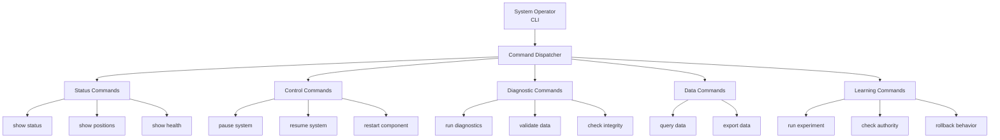

# System Operator

The **System Operator** (`aletheia/operator/`) is the interactive command-line interface (CLI) for system monitoring, control, and diagnostics. It provides a REPL (Read-Eval-Print Loop) interface for real-time inspection, as well as batch command execution for scripted operations.

## Architecture



## Command Categories

### Status Commands

**Source:** `operator/status.py`

| Command | Description |
|---|---|
| `show status` | Overall system status (uptime, regime, stage) |
| `show positions` | Active positions with P&L |
| `show health` | Component health summary |
| `show metrics` | Key performance metrics |
| `show opportunities` | Current opportunity set |
| `show learning` | Learning stage, autonomy level |

### Control Commands

**Source:** `operator/control.py`

| Command | Description |
|---|---|
| `pause system` | Pause all trading activity |
| `resume system` | Resume trading activity |
| `restart <component>` | Restart a specific component |
| `force exit <symbol>` | Force close a position |
| `disable trading` | Disable all trading |
| `enable trading` | Enable trading |
| `set regime <name>` | Override current regime (testing) |

### Diagnostic Commands

**Source:** `operator/diagnostics.py`

| Command | Description |
|---|---|
| `run diagnostics` | Full system diagnostics |
| `validate data` | Validate data freshness and integrity |
| `check integrity` | Verify audit hash chain |
| `test connection` | Test exchange API connections |
| `check budget` | Check LLM token/cost budget |
| `debug <component>` | Detailed component debug info |

### Data Commands

**Source:** `operator/data.py`

| Command | Description |
|---|---|
| `query data` | SQL-like data queries |
| `export data` | Export data to CSV/JSON |
| `import data` | Import historical data |
| `clean data` | Clean stale/redundant data |

### Learning Commands

**Source:** `operator/learning.py`

| Command | Description |
|---|---|
| `run experiment <behavior>` | Start a learning experiment |
| `check authority` | Show current learning authority |
| `rollback behavior <id>` | Rollback a learned behavior |
| `freeze behavior <id>` | Freeze a learned behavior |
| `promote stage` | Advance to next learning stage |
| `show experiments` | List all experiments |

## Interactive REPL

```bash
$ python -m aletheia.operator.cli

Aletheia System Operator v2.1
System Status: RUNNING | Regime: BULL | Stage: AT-01

> show positions
Symbol    Direction    Qty      Entry      Current    P&L
BTCUSDT   LONG         0.01     $45000     $46500     +3.3%
ETHUSDT   SHORT        0.10     $3000      $2900      +3.3%

> show health
Component           Status    Last Check    Errors
Data Collector      HEALTHY   2024-01-15    0
Risk Engine         HEALTHY   2024-01-15    0
Knowledge Base      HEALTHY   2024-01-15    0

> show learning
Learning Stage: 1
Autonomy Level: PAPER
Active Experiments: 2
```

## Batch Mode

```bash
# Execute a command without entering REPL
python -m aletheia.operator.cli --batch "show status"

# Execute multiple commands from a file
python -m aletheia.operator.cli --batch-file commands.txt

# Export data with output
python -m aletheia.operator.cli --batch "export data --table market_data --format csv"
```

## Alerting

**Source:** `operator/alerting.py`

The System Operator can receive alerts via:

| Channel | Description |
|---|---|
| **Console** | REPL and batch output |
| **Discord** | Webhook alerts for critical issues |
| **Email** | Daily summary reports |
| **JSONL** | Alert log file |

### Alert Types

| Alert | Severity | Trigger |
|---|---|---|
| System paused | CRITICAL | Trading paused |
| Component unhealthy | CRITICAL | Health check failed |
| Data stale | WARNING | Data freshness expired |
| Budget exceeded | WARNING | Token budget at 90% |
| Learning verdict | INFO | Experiment verdict available |
| Regime change | INFO | Regime transitioned |

## Command History

All commands are logged to the `operator_commands` table:

```python
{
    "command": "show positions",
    "user": "system",
    "timestamp": "2024-01-15T10:30:00Z",
    "duration_ms": 45,
    "success": True
}
```

## Key Symbols

| Symbol | Location | Description |
|---|---|---|
| `OperatorCLI` | `operator/cli.py` | Main CLI class |
| `CommandDispatcher` | `operator/dispatcher.py` | Command routing |
| `StatusCommands` | `operator/status.py` | Status command handlers |
| `ControlCommands` | `operator/control.py` | Control command handlers |
| `DiagnosticCommands` | `operator/diagnostics.py` | Diagnostic command handlers |
| `send_alert` | `operator/alerting.py` | Alert dispatch |
| `ALERT_CONFIG` | `operator/alerting.py` | Alert channel config |
| `log_command` | `operator/cli.py` | Command logging |

## Test Coverage

- `tests/test_operator_cli.py` — Tests for CLI command parsing
- `tests/test_operator_status.py` — Tests for status commands
- `tests/test_operator_control.py` — Tests for control commands
- `tests/test_operator_diagnostics.py` — Tests for diagnostic commands
- `tests/test_operator_alerting.py` — Tests for alert dispatch

## Relationship to Other Components

- [Runtime Engine](engine.md) — Control commands (pause/resume)
- [Learning System](../components/learning-system.md) — Learning commands
<!-- openwiki: broken internal link [data-layer/overview.md] file "data-layer/overview.md" does not exist. Fix the href or restore the target, then delete this comment. -->
- [Data Layer](data-layer/overview.md) — Data export/import
- [Risk Engine](../components/risk-engine.md) — Health monitoring
- [Execution Gateway](../components/execution-gateway.md) — Order control
