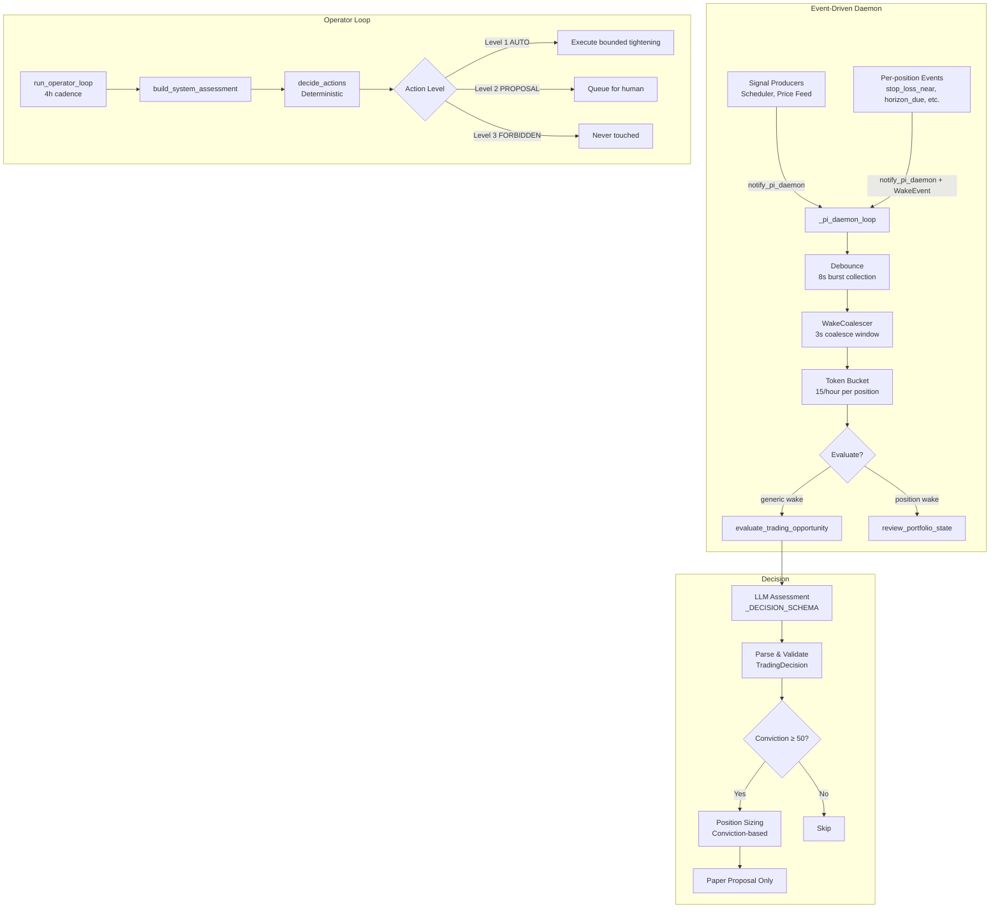

# System Operator

The **System Operator** is Aletheia's sole entry-decision authority. It is an event-driven daemon that evaluates trading opportunities via LLM, with wake-event coalescing and per-position rate limiting. It also runs an autonomous system governance loop at 4-hour cadence.

## Architecture



## Event-Driven Daemon (`agent_runtime/pi_daemon.py`)

The PI Daemon runs as a long-lived `asyncio.Task` inside the uvicorn event loop. See [Agent Decision Loop](../architecture/agent-decision-loop.md) and [PI Daemon Service](../services/pi-daemon.md) for full details.

### Public API

| Function | Signature | Description |
|---|---|---|
| `notify_pi_daemon` | `(source: str = "unknown", event: WakeEvent \| None = None) -> bool` | Thread-safe signal to wake the daemon. |
| `start_pi_daemon` | `(loop, debounce_sec=8.0, cooldown_sec=60.0, heartbeat_sec=300.0, ...) -> asyncio.Task \| None` | Creates the daemon task. |
| `stop_pi_daemon` | `() -> None` | Cancels the task, clears module-level state. |
| `reconfigure_pi_daemon` | `(enabled, debounce_sec, cooldown_sec, heartbeat_sec, loop) -> dict` | Hot-reconfigures without gateway restart. |

### Internal Loop (`_pi_daemon_loop`)

1. **Wait** — Awaits `_signal_event` with dynamic timeout.
2. **Debounce** — Sleeps `debounce_sec` (8s) to collect burst signals.
3. **Runtime guards** — Checks `cfg.runtime.paused` and `cfg.agent.permission_mode`.
4. **Coalescer drain** — Drains `_pending_events` into the `WakeCoalescer`.
5. **Evaluation gate** — Evaluates on generic wake, heartbeat, or rate-passing position events.
6. **Evaluation** — Acquires `_eval_lock`, calls `_run_evaluation`.
7. **Cooldown** — Bounded sleep before next cycle.

These are runtime control-flow steps, not implementation stages.

## Trading Decision (`agent_shell/trading_decision.py`)

`evaluate_trading_opportunity()` is the System Operator's ability to act as Trading Decision Authority.

### `TradingDecision` Dataclass

Rich decision object with:
- `action` ("trade" | "skip"), `symbol`, `direction`, `conviction` (0–100), `reasoning`
- `position_size_usdt`, `stop_price`, `take_profit`, `expected_horizon_hours`
- `order_type` ("market" | "limit"), `market_type`, `venue`, `leverage`
- Debate fields: `debate_ran`, `debate_initial_conviction`, `debate_bull_confidence`, `debate_bear_confidence`
- attribution: `opportunity_id`, `strategy_id`, `scanner_family`, `signal_source`
- reasoning detail: `bear_case`, `key_assumptions`, `observed_facts`, `interpretations`, `invalidation_conditions`

### Decision Flow

1. `_assess_opportunity(ctx)` — LLM structured call with `_DECISION_SCHEMA`.
2. `_parse_decision(raw)` — Validates and parses raw LLM output into `TradingDecision`.
3. On malformed → `_reassess_direct_skip` (one bounded correction pass).
4. `_attach_opportunity_context` — matches pick back to source opportunity.
5. Entry plan preflight — Validates entry mark.
6. If conviction in uncertain range (40–80) → Bull/Bear debate.
7. Conviction-based position sizing.

This is the runtime decision flow; the numbering has no project-delivery meaning.

### Safety

The System Operator can only submit **paper** proposals (PaperAuto permission gate). Live trading is never reachable from this path.

### Thresholds

```python
_MIN_CONVICTION_TO_TRADE = 50
_DEBATE_RANGE = (40, 80)
_MAX_CONVICTION_MULTIPLIER = 2.0
_MIN_CONVICTION_MULTIPLIER = 0.5
```

## Operator Loop (`agent_shell/operator_loop.py`)

Autonomous system governance at 4h cadence. The Operator is a **Supervisor, not an Executor** — it consumes outputs from bottom-level jobs, adjusts config to indirectly shape behavior, and delegates one-off tasks to specialist agents.

### Three permission levels:

- **Level 1 (AUTO):** bounded tightening/recovery actions and notifications
- **Level 2 (PROPOSAL):** loosening and unknown actions — queued for human
- **Level 3 (FORBIDDEN):** kill_switch, live mode, risk hard limits — never touched

### `run_operator_loop(trigger="scheduled") -> dict`

Main entry — called by scheduler every 4h.

**Runtime flow:**

- **Assessment** — `build_system_assessment()`
- **Decision** — `decide_actions(assessment)`
- **Action** — execute each approved action according to its permission level
- **Persistence** — persist the resulting assessment as `knowledge_item`

These names describe runtime semantics only; they are not development stages.

### `SystemAssessment` Dataclass

Comprehensive snapshot including:
- Strategy pool metrics, uncovered symbols, underperforming strategies
- Trading performance (24h/48h/7d), win rate, profit factor, streak
- Exit composition, data health, risk state, scanner calibration
- Filter pressure, param drift, candidate supply drought, content health

### Rate limiting:

- `_MAX_CONFIG_PATCHES_PER_DAY = 3`
- `_COOLDOWN_SECONDS = 7200` (2h same-param cooldown)
- `_MAX_NOTIFICATIONS_PER_DAY = 10`
- Persistent action log in `audit_events` table (survives restarts).

### Decision rules (`decide_actions`):

- Content-health anomalies → notify
- Win rate < 35% → reduce sizing 20%
- Confidence recovery (drought/streak) → loosen confidence to neutral
- Streak ≥ 3 + PF ≥ 1.5 → increase sizing toward neutral
- TP exits ≥ 70% → propose widen stop loss
- Healthy WR (45–65%) → neutral drift one param per cycle
- Kill switch active → notify

## Wake Events (`agent_runtime/wake_events.py`)

### Event Kinds & Priorities

| Kind | Priority | Description |
|---|---|---|
| `catastrophic` | P0 | Bypasses rate limit, pre-empts |
| `stop_loss_near` | P1 | Must-answer: never dropped |
| `thesis_invalidated` | P1 | Must-answer: never dropped |
| `horizon_due` | P1 | Must-answer: never dropped |
| `adverse_signal` | P2 (default) | May be overridden by score |
| `take_profit_near` | P3 | Dropped under pressure |

### `WakeCoalescer.ready_batches(now)` — Core Algorithm

For each pending position:
- Eligible when: coalesce window elapsed OR a P0 event is present.
- P0 batches emit immediately (bypass token bucket).
- Other eligible batches consume one token. If none:
  - Priority ≤ P1 → requeue (kept, retried when token refills)
  - Priority ≥ P2 → dropped (heartbeat re-scans)

## Key Invariants

1. **Sole decision authority** — The System Operator is the sole entry-decision authority for trades.
2. **Paper-only path** — Live trading is never reachable from the evaluate_trading_opportunity path.
3. **Supervisor, not Executor** — The Operator adjusts config to indirectly shape behavior.
4. **Coalescing** — Events for the same position within 3s collapse into ONE batch.
5. **Rate limiting** — Per-position token bucket (15/hour).

## Relationship to Other Components

- [Agent Decision Loop](../architecture/agent-decision-loop.md) — The full decision pipeline
- [PI Daemon Service](../services/pi-daemon.md) — Runtime deployment view
- [Agent Runtime](engine.md) — The infrastructure layer
- [Trading Loop](../architecture/trading-loop.md) — Full evidence pipeline
