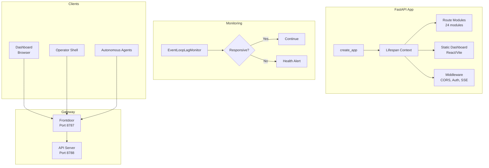

# API Server

The **API Server** is Aletheia's FastAPI backend. It exposes the REST/WebSocket API, mounts the React/Vite dashboard, and serves as the primary control surface for both human operators and autonomous agents.

## Architecture

## App Construction (`server/app.py`)

### `create_app() -> FastAPI`

Constructs the FastAPI app with:
- Lifespan context (startup/shutdown)
- 24 route modules
- Static dashboard mount
- Middleware (CORS, auth, SSE)

## Route Modules (`server/routes/`)

24 route modules covering:
- Agent runtime (scheduler, health, permissions)
- Trading (proposals, positions, orders, fills)
- Universe (scanners, features, allocation)
- Portfolio (PnL, paper account, exits)
- Risk (engine, kill switch, policy)
- Learning (experiments, lifecycle, authority)
- Knowledge (items, guards, search)
- Config (settings, exchange, model provider)
- Gateway (lifecycle, status, logs)
- Frontend (dashboard, static)

## Dev Reload (`server/dev_reload.py`)

Dev auto-reload gating (not enabled in production).

## Responsiveness (`server/responsiveness.py`)

### `EventLoopLagMonitor`

Detects if the ASGI event loop is unresponsive. Triggers health alerts when lag exceeds thresholds.

## Startup Policy (`server/startup_policy.py`)

Defines the server's startup behavior and initialization order.

## Key Invariants

1. **Decoupled HTTP** — HTTP/WebSocket concerns are decoupled from the agent runtime.
2. **Front-door proxy** — The server is mounted behind the gateway's front-door proxy.
3. **Dashboard mount** — The React/Vite dashboard is served from the same FastAPI app.
4. **Event loop monitoring** — Responsiveness is monitored to detect ASGI event loop stalls.

## Relationship to Other Components

- [Gateway](gateway.md) — Manages the server process
- [Agent Decision Loop](../architecture/agent-decision-loop.md) — Consumes API data
- [Trading Loop](../architecture/trading-loop.md) — Full evidence pipeline
