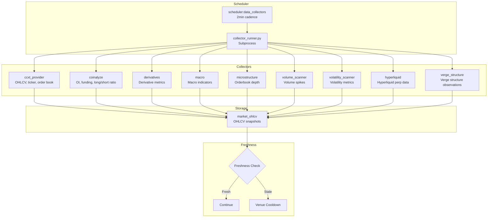

# Data Collectors

The **Data Collectors** subsystem is Aletheia's market data collection pipeline. It runs 9+ collectors in an isolated subprocess, each writing to dedicated tables in SQLite, with freshness validation and provider fallback.

## Architecture

## Collector Runner (`data/collector_runner.py`)

The collector runner spawns all collectors in an isolated subprocess. This prevents thread explosion in the main gateway process.

**Key design:**
- Each collector runs concurrently with bounded parallelism.
- Collectors write directly to SQLite tables.
- The runner reports health status back to the scheduler.

## Collector Types

| Collector | Data | Storage |
|---|---|---|
| `ccxt_provider` | OHLCV, ticker, order book (primary + fallback CCXT) | `market_ohlcv` |
| `coinalyze` | Open interest, funding rates, long/short ratio | `funding_rate_snapshots`, `open_interest_snapshots` |
| `derivatives` | Derivative metrics | `perp_structure_snapshots` |
| `macro` | Macro indicators (BTC dominance, SPY, VIX, DXY) | `macro_snapshots` |
| `microstructure` | Orderbook depth, bid-ask spread | `orderbook_snapshots` |
| `volume_scanner` | Volume spikes | `market_ohlcv` |
| `volatility_scanner` | Volatility metrics | `market_ohlcv` |
| `hyperliquid` | Hyperliquid perp data | `market_ohlcv` |
| `verge_structure` | Verge structure observations | `perp_structure_snapshots` |
| `news_collector` | RSS news feeds | `news_items` |
| `news_analyzer` | LLM sentiment + symbol extraction | `news_items` (enriched) |

## Storage Layout (`storage/market_ohlcv_layout.py`)

OHLCV data is stored in the `market_ohlcv` table with a composite primary key: `(exchange, symbol, market_type, timeframe, ts)`.

**Tiering (`storage/market_ohlcv_tiering.py`):**
- Different timeframes have different retention policies.
- Recent data is kept at full granularity.
- Older data is downsampled or pruned.

## Freshness Validation

Freshness is validated by the scheduler's `market_data` job (5 min cadence). Stale data triggers:
- Venue cooldown in `venue_health.py`
- Health alerts via `agent_runtime/health.py`

## Key Invariants

1. **Isolated subprocess** — Collection runs in a separate subprocess to prevent thread explosion.
2. **Dedicated tables** — Each collector writes to dedicated tables in SQLite.
3. **Freshness validation** — Stale data triggers venue cooldown.
4. **Provider fallback** — CCXT providers have fallback chains for reliability.

## Relationship to Other Components

- [Scheduler](../architecture/scheduler.md) — Orchestrates collection jobs
- [Universe Pipeline](../components/universe.md) — Consumes collected data
- [Gateway](gateway.md) — Manages the collector subprocess
- [Trading Loop](../architecture/trading-loop.md) — Full evidence pipeline
