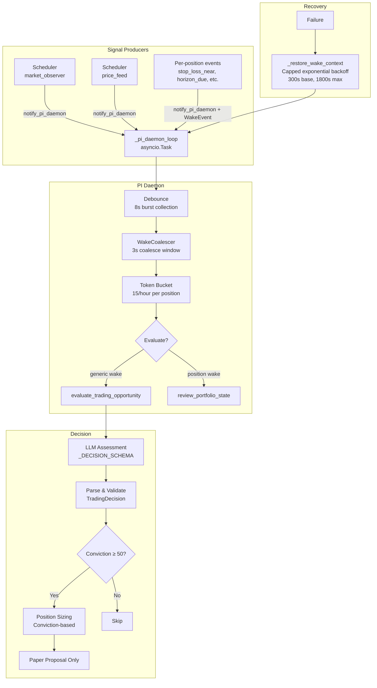

# PI Daemon Service

The **PI Daemon** is Aletheia's event-driven System Operator daemon. It runs as a long-lived `asyncio.Task` inside the uvicorn event loop, replacing the old 15-minute APScheduler poll with immediate, coalesced, rate-limited evaluation.

## Architecture



## Public API

| Function | Signature | Description |
|---|---|---|
| `notify_pi_daemon` | `(source: str = "unknown", event: WakeEvent \| None = None) -> bool` | Thread-safe signal to wake the daemon. Fire-and-forget. |
| `start_pi_daemon` | `(loop, debounce_sec=8.0, cooldown_sec=60.0, heartbeat_sec=300.0, coalesce_window_sec=3.0, wake_capacity=15, wake_refill_per_hour=15.0) -> asyncio.Task \| None` | Creates the daemon task named `"pi_daemon"`. |
| `stop_pi_daemon` | `() -> None` | Cancels the task, clears module-level state. |
| `reconfigure_pi_daemon` | `(enabled, debounce_sec, cooldown_sec, heartbeat_sec, loop) -> dict` | Hot-reconfigures without gateway restart. |
| `daemon_status` | `() -> dict` | Rich status: running, heartbeat_age, consecutive_failures, signal_pending_queue_depth. |

## Internal Loop (`_pi_daemon_loop`)

1. **Wait phase** — Awaits `_signal_event` with dynamic timeout (min of: next retry delay, next defer deadline, heartbeat backstop).
2. **Debounce** — Sleeps `debounce_sec` (8s) to collect burst signals.
3. **Runtime guards** — Checks `cfg.runtime.paused` and `cfg.agent.permission_mode` (must be `"Paper"` or `"Full"`).
4. **Coalescer drain** — Drains `_pending_events` into the `WakeCoalescer`, pulls rate-limited coalesced batches.
5. **Evaluation gate** — Evaluates on generic wake, heartbeat, or rate-passing position events.
6. **Evaluation** — Acquires `_eval_lock`, calls `_run_evaluation`.
7. **Cooldown** — Bounded sleep before next cycle.

## `_run_evaluation`

- Selects evaluator: `review_portfolio_state` if per-position batches exist, else `evaluate_trading_opportunity`.
- Wraps in `bind_economic_attribution` for R0 attribution.
- 300s timeout.
- On failure: applies capped exponential backoff via `_restore_wake_context`.

## Wake Events (`agent_runtime/wake_events.py`)

### Event Kinds & Priorities

| Kind | Priority | Description |
|---|---|---|
| `catastrophic` | P0 | Bypasses rate limit, pre-empts |
| `stop_loss_near` | P1 | Must-answer: never dropped |
| `thesis_invalidated` | P1 | Must-answer: never dropped |
| `horizon_due` | P1 | Must-answer: never dropped |
| `adverse_signal` | P2 (default) | May be overridden by score |
| `take_profit_near` | P3 | Dropped under pressure |

### `WakeCoalescer.ready_batches(now)` — Core Algorithm

For each pending position:
- Eligible when: coalesce window elapsed OR a P0 event is present.
- P0 batches emit immediately (bypass token bucket).
- Other eligible batches consume one token. If none:
  - Priority ≤ P1 → requeue (kept, retried when token refills)
  - Priority ≥ P2 → dropped (heartbeat re-scans)

## Runtime Session (`agent_runtime/runtime_session.py`)

### `start_runtime_session(cfg=None, runtime_context=None) -> dict`

Creates + persists a `RuntimeSession`, sets as current. Every gateway process boot creates one `runtime_sessions` row.

**Session hierarchy:**
```
runtime-abc123                 (runtime_id — the running version)
  ├── session-001  first boot
  ├── session-002  gateway restart
  └── session-003  restart after a config change
```

### `current_provenance() -> dict`

Provenance to stamp on child rows: `{runtime_session_id, producer_commit, behavior_fingerprint}`.

## Key Invariants

1. **Event-driven** — Replaces the old 15-minute APScheduler poll with immediate evaluation.
2. **Coalescing** — Events for the same position within 3s collapse into ONE batch.
3. **Rate limiting** — Per-position token bucket (15/hour).
4. **Priority** — P0 catastrophic bypasses; P1 urgent never drops; P3 low drops under pressure.
5. **Fail-closed** — On failure, applies capped exponential backoff (300s base, 1800s max).

## Relationship to Other Components

- [Agent Decision Loop](../architecture/agent-decision-loop.md) — The full decision pipeline
- [Scheduler](../architecture/scheduler.md) — Signal producers that wake the daemon
- [Gateway](gateway.md) — Manages the server process
- [Trading Loop](../architecture/trading-loop.md) — Full evidence pipeline
